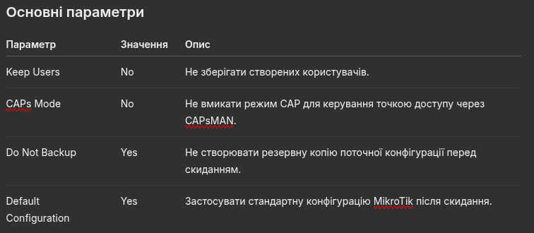

## MikroTik — System → Reset Configuration

Reset Configuration — функція скидання налаштувань маршрутизатора MikroTik до початкового стану.

## Що відбувається після Reset Configuration?

- Видаляються поточні налаштування маршрутизатора.
- Скидаються налаштування IP-адрес.
- Скидаються налаштування DHCP Server.
- Скидаються правила Firewall.
- Скидаються налаштування Wi-Fi та інших мережевих сервісів.
- Застосовується стандартна конфігурація MikroTik.

## Default Configuration

Існує два варіанти:

- **Yes** — після скидання MikroTik застосовує стандартну конфігурацію.
- **No** — після скидання MikroTik запускається з порожньою конфігурацією, яку потрібно налаштовувати вручну.