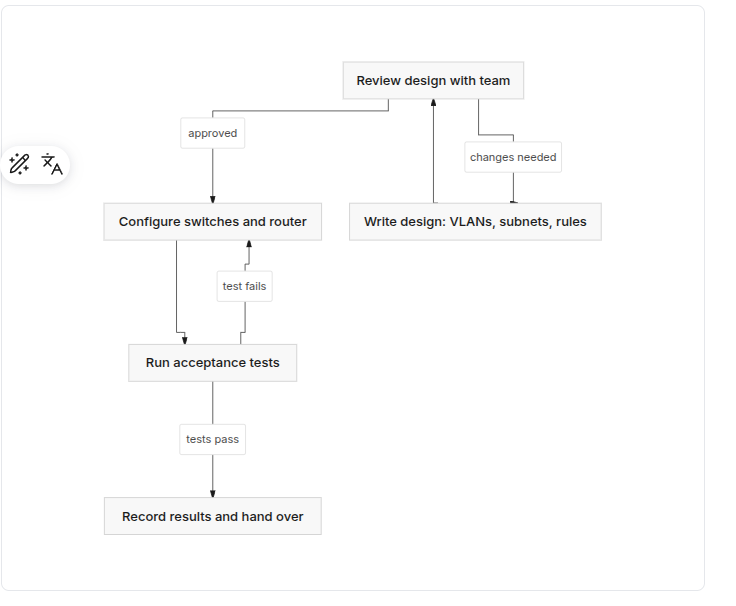
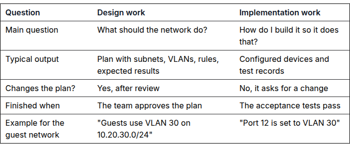

## Проектування та впровадження
Невеликий офіс потребує гостьової мережі Wi-Fi. Гості повинні мати доступ до Інтернету, але не повинні мати доступу до принтера чи файлового сервера персоналу. Перш ніж хтось почне налаштовувати комутатор, хтось має вирішити, як це реалізувати. Це рішення — це проектування. Втілення цього рішення у вигляді робочого обладнання — це впровадження. Цей урок охоплює обидва процеси та пояснює, чим вони відрізняються.


Що дає робота з проектування
Робота з проектування відповідає на питання: що має робити мережа і як вона це робитиме? Результатом є план, який інші люди можуть перевірити та реалізувати.


Для цього офісу проектувальник може вирішити:


Пристрої співробітників використовують VLAN 10 із підмережею 10.20.10.0/24.
Сервери використовуватимуть VLAN 20 із підмережею 10.20.20.0/24.
Гостьові пристрої використовуватимуть VLAN 30 із підмережею 10.20.30.0/24.
Маршрутизатор з адресою 10.20.30.1 є шлюзом для гостей. Трафік гостей може надходити в Інтернет, але не в VLAN 10 або VLAN 20.
VLAN (віртуальна локальна мережа) розділяє один фізичний комутатор на окремі логічні мережі. Пристрої в різних VLAN не можуть взаємодіяти між собою, якщо це не дозволено маршрутизатором. Підмережа — це діапазон IP-адрес, що належить до однієї мережі.


Зверніть увагу на деталі підмережі. Префікс /24 означає, що перші 24 біти є фіксованими. Останні 8 бітів є вільними. Кількість адрес становить:

$2^8 = 256$

Дві з цих адрес не можуть бути присвоєні одному пристрою. Одна з них — це мережева адреса, а інша — адреса широкомовлення. Отже, кількість доступних хостів становить:

$256−2=254$

VLAN для гостей може вмістити 254 пристрої. Для невеликого офісу цього достатньо. Проектувальник перевіряє таку кількість ще до початку розгортання, оскільки пізніше виправити неправильно обрану підмережу обійдеться дорого.


Проект також включає правила на випадок збоїв та перевірки. Проектувальник складає приймальний тест: перевірку, яка демонструє, що мережа працює відповідно до проекту. Для гостьової мережі тест може виглядати так:


Гостьовий ноутбук отримує адресу з діапазону 10.20.30.0/24.
Ноутбук отримує доступ до загальнодоступного веб-сайту.
Ноутбук не може підключитися до 10.20.10.5 — принтера для персоналу.
Якщо у проекті не вказано ці очікувані результати, пізніше ніхто не зможе визначити, чи правильно виконано розгортання.


## Що дає робота з впровадження
Робота з впровадження перетворює план на реальне обладнання та налаштування. Інженер виконує фізичні та логічні кроки: прокладає кабелі, налаштовує порти комутатора, створює VLAN, встановлює правила маршрутизатора та підключає точку доступу.


Виконавець дотримується проекту. Він не обирає нові підмережі чи нові номери VLAN на власний розсуд. Якщо у проекті вказано VLAN 30, порт комутатора для гостьової точки доступу повинен бути налаштований на VLAN 30. Якщо спеціаліст з впровадження вважає, що VLAN 40 підійде краще, правильним кроком буде звернутися з проханням про зміну проекту, а не змінювати номер самостійно.


Впровадження завершується, коли інженер проводить приймальні випробування та фіксує їхні результати. Налаштований пристрій не є доказом того, що проект працює. Доказом є випробування.

## Як відбувається передача між двома етапами
Ці два види роботи виконуються за циклічною схемою. Спочатку відбувається проектування. Потім — реалізація. На етапі тестування вирішується, чи робота завершена, чи її потрібно повернути на етап реалізації або проектування.



Цей цикл має велике значення. Невдалий тест часто означає, що конфігурація не відповідає проекту. Іноді це означає, що проект був неправильним, наприклад, правило, яке блокує пристрій, який дійсно потрібен офісу. У такому випадку інженер повертається до проекту, оновлює його, а потім змінює конфігурацію.


## Порівняння двох видів роботи



Subnetting Task №1 — Usable Host Addresses
Scenario:

The office adds a second guest group, a kiosk, that needs its own VLAN.

The network administrator has allocated the following subnet:

10.20.40.0/24

$32 - 24  = 8$
$ 2^8 = 256$
$256 - 2 = 254$ 


# Subnetting — Кількість доступних IP-адрес

## 1. Основна формула

Для розрахунку кількості доступних IP-адрес у підмережі використовується формула:

\[
\boxed{2^h - 2}
\]

Де:
- \(h\) — кількість бітів, виділених під адреси пристроїв (Host Bits).
- \(2^h\) — загальна кількість IP-адрес у підмережі.
- \(-2\) — дві зарезервовані адреси: Network Address та Broadcast Address.

## 2. Як розрахувати кількість Host Bits

IPv4-адреса складається з 32 бітів.

Формула:

\[
h = 32 - CIDR
\]

**Приклад:**

```text
192.168.10.0/24
```

Розрахунок:

\[
h = 32 - 24 = 8
\]

Отже, для адрес пристроїв доступно 8 бітів.

## 3. Розрахунок кількості доступних IP-адрес

Використовуємо основну формулу:

\[
2^8 - 2 = 256 - 2 = 254
\]

**Результат: 254 доступні IP-адреси для пристроїв.**

## 4. Таблиця поширених CIDR-префіксів

| CIDR | Host Bits | Загальна кількість IP | Доступні IP |
|---|---:|---:|---:|
| /24 | 8 | 256 | 254 |
| /25 | 7 | 128 | 126 |
| /26 | 6 | 64 | 62 |
| /27 | 5 | 32 | 30 |
| /28 | 4 | 16 | 14 |
| /29 | 3 | 8 | 6 |
| /30 | 2 | 4 | 2 |

## 5. Важливі поняття

- **Network Address** — мережева адреса, яка ідентифікує підмережу.
- **Broadcast Address** — широкомовна адреса для звернення до всіх пристроїв підмережі.
- **Usable Host Addresses** — IP-адреси, які можна призначити пристроям.

## 6. Головне, що потрібно запам'ятати

Формула для розрахунку кількості доступних IP-адрес:

\[
\boxed{Usable\ Hosts = 2^{(32-CIDR)} - 2}
\]

**Алгоритм:**
1. Від 32 віднімаємо CIDR-префікс.
2. Підносимо 2 до отриманого степеня.
3. Від результату віднімаємо 2.

