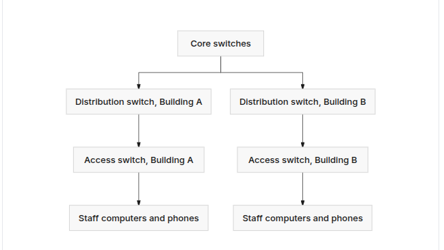
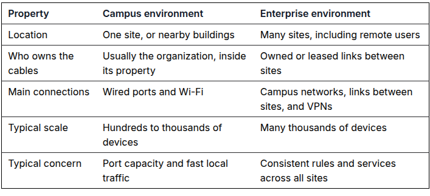

## Корпоративні та університетські середовища

Лікарня має три будівлі, розташовані на одній ділянці. Лікарі, медсестри та адміністративний персонал користуються комп’ютерами, телефонами та принтерами у всіх трьох будівлях. Кожна будівля потребує мережі, яка з’єднує ці пристрої між собою та з системами, що використовуються в лікарні. Мережа, яка охоплює цю одну ділянку, є кампусною мережею. Повна мережа лікарні, яка також може включати інші об’єкти та співробітників, що працюють з дому, є корпоративною мережею. Мережеві інженери працюють в обох мережах, але їхня робота в кожній з них відрізняється.

## Що таке корпоративне середовище

Підприємницьке середовище — це вся мережа однієї організації. Організація — це компанія, лікарня, школа або державний орган. Підприємницька мережа охоплює всі місця, де підключаються пристрої організації, а не лише одну будівлю.

Типова корпоративна мережа складається з кількох частин:

однієї або кількох локальних мереж, де співробітники працюють на одній території
інших об’єктів, таких як офіси в інших містах
серверів та систем, на яких працюють додатки організації
підключень для віддалених співробітників, часто через VPN (віртуальну приватну мережу, яка передає трафік через зашифрований тунель у публічному Інтернеті)

Корпоративна мережа лікарні охоплює її кампус, але також включає й інші об’єкти. Припустимо, що лікарня має невелику клініку в іншому місті з 20 пристроями, а 15 ноутбуків співробітників підключаються з дому. Підприємство має такі кінцеві точки — пристрої, що надсилають і отримують мережевий трафік:

Результат обчислення: 126 + 20 + 15 = 161.

Як мережевий інженер, ви розглядаєте підприємство як єдину систему. Зміна на одному об’єкті може вплинути на користувачів на іншому. Наприклад, нове правило брандмауера в головному офісі може заблокувати доступ клініки до спільної системи. Обов’язки, про які ви дізналися в розділі «Мережева інженерія в організаціях», застосовуються саме в цьому масштабі: ваша робота сприяє досягненню цілей організації, а не лише задоволенню потреб однієї команди.

## Що таке кампусна мережа

Кампусна мережа — це мережа, яка охоплює одну територію. Ця територія — це одна ділянка або група будівель, розташованих поруч, наприклад, університет, лікарня чи офісний парк. Оскільки будівлі знаходяться поруч, інженер є власником кабелів, що з’єднують їх. Користувачі підключаються до мережі за допомогою кабелю або Wi-Fi.

Кампусна мережа зазвичай будується за принципом багатошаровості. Кожен шар виконує одне завдання:

До комутатора доступу підключаються пристрої. Кожен комутатор доступу має багато портів, і до кожного порту підключається один пристрій.

Рівень розподілу об’єднує комутатори доступу однієї будівлі або зони та застосовує правила, наприклад, які користувачі можуть отримувати доступ до яких систем.

Ядро забезпечує швидку передачу трафіку між будівлями та рештою підприємства.
Така багаторівнева структура є загальноприйнятою практикою, а не обов’язковою вимогою. У невеликих кампусах рівні можуть бути об’єднані. У великих кампусах їх кількість може бути більшою.

## Підрахунок кількості портів для однієї будівлі

Кількість портів визначає, скільки комутаторів потрібно для будівлі. Припустимо, що кожен комутатор доступу має 48 портів. Два порти є лініями зв’язку з верхнім рівнем, які підключають комутатор до розподільного рівня. Отже, для підключення пристроїв залишається 46 портів.

У будівлі А потрібно 30 робочих комп’ютерів і 12 IP-телефонів, тому для неї потрібно 42 порти:

30 комп’ютерів + 12 телефонів = потрібно 42 порти
46 доступних портів – 42 необхідні порти = 4 вільні порти

Для будівлі А достатньо одного комутатора доступу. 4 вільні порти дозволяють підключити кілька нових пристроїв. Передбачайте можливість розширення. Якщо в будівлі потрібно 47 портів, одного комутатора буде недостатньо — доведеться додати другий.

На території кампусу розташовано три будівлі з однаковою кількістю пристроїв. Загальна кількість становить:

3 будівлі × 42 пристрої = 126 пристроїв

Це відповідає показнику для кампусу в наведеному вище прикладі для підприємства.

## Порівняння двох середовищ

Скористайтеся цією таблицею, щоб побачити відмінності. Кампус є частиною підприємства, тому кожен кампус знаходиться в межах корпоративної мережі, проте не кожне підприємство складається виключно з кампусу.

Зверніть увагу на різницю в підходах. У межах кампусу ви перевіряєте, чи достатньо в будівлі портів і чи забезпечені швидкісні з’єднання. У масштабах усього підприємства ви дбаєте про те, щоб користувач, незалежно від свого місцезнаходження, отримував однаковий рівень доступу та якість обслуговування.

Вправи

У будівлі є 40 комп’ютерів для співробітників і 10 IP-телефонів. Кожен комутатор доступу має 48 портів, 2 з яких — висхідні (uplink). Скільки комутаторів потрібно для цієї будівлі? Наведіть розрахунок.

Відповідь: Для будівлі потрібно 50 портів (40 + 10 = 50). Кожен комутатор має 46 портів для підключення пристроїв (48 - 2 = 46). Одного комутатора недостатньо, оскільки 50 більше за 46. Два комутатори забезпечують 92 порти для пристроїв, чого цілком достатньо; отже, для будівлі потрібно 2 комутатори.

Компанія має кампус зі 126 пристроями, клініку з 20 пристроями, а також 15 віддалених ноутбуків. Що з цього належить до середовища кампусу, а що — виключно до середовища підприємства?

Відповідь: 126 пристроїв у кампусі належать як до середовища кампусу, так і до середовища підприємства. 20 пристроїв у клініці та 15 віддалених ноутбуків належать лише до середовища підприємства, оскільки вони не розташовані на території кампусу.

Підсумок

Середовище кампусу — це мережа на одній території, побудована за багаторівневим принципом: від комутаторів доступу до ядра мережі. Середовище підприємства — це вся мережа організації, яка може охоплювати кілька кампусів, інші локації та віддалених користувачів. Такі поняття, як кількість портів і багаторівнева структура, стосуються кампусу. Забезпечення однакового рівня обслуговування в усіх локаціях — це характеристика підприємства. Далі, у контексті центрів обробки даних (ЦОД) і постачальників послуг, ви дізнаєтеся про об’єкти, де розміщуються численні сервери та зовнішні мережеві провайдери — поза межами кампусів і філій.