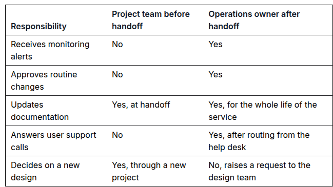

## Відповідальність за операції та обслуговування

Через десять днів після запуску Wi-Fi у торговому залі до служби підтримки звертається користувачка. Її ноутбук не може підключитися до внутрішньої системи продажів. Хто повинен це виправити? Відповідь залежить від того, хто є власником цієї послуги. У подальшій частині цього уроку розповідається про повсякденну роботу, яка забезпечує безперебійне функціонування послуги, а також про команду, відповідальну за цю роботу.

## Експлуатація як повсякденна робота

Експлуатація — це робота, яка забезпечує безперебійне функціонування сервісу. Дизайн визначає, що потрібно створити. Реалізація — це створення. Експлуатація — це щоденне забезпечення роботи сервісу після його запуску.

Завдання з експлуатації мережі зазвичай невеликі та рутинні. Типові завдання включають:

Відстежувати сповіщення систем моніторингу та перевіряти їх.
Перевіряти працездатність каналів зв’язку та пристроїв.
Впроваджувати затверджені зміни у запланований проміжок часу для технічного обслуговування.
Перевірка пропускної здатності, наприклад, скільки користувачів обслуговує кожна точка доступу.
Поновлення сертифікатів та ліцензій до закінчення їхнього терміну дії.
Перегляд журналів, коли користувачі повідомляють про несправності.
Підтримка документації в актуальному стані.
Ось невеликий приклад. Мережа Wi-Fi у торговому залі має 12 точок доступу та 360 користувачів у години пікового навантаження. Середнє навантаження становить:

$360 / 12 = 30$ користувачів на одну точку доступу

Припустимо, команда налаштувала сповіщення для будь-якої точки доступу, на якій перебуває понад 45 користувачів. О 09:00 система моніторингу показує, що на точці доступу AP-07 перебуває 52 користувачі. Оскільки 52 > 45, спрацьовує сповіщення. Інженер з експлуатації перевіряє AP-07, перенаправляє частину користувачів на сусідні точки доступу та фіксує виконані дії. Ніхто не перепроектував мережу. Інженер скористався діючою службою та її узгодженими обмеженнями.

Відділ експлуатації також встановлює стандарти для сервісу. Команди часто домовляються про цільовий показник доступності — частку часу, протягом якої сервіс повинен працювати. Розглянемо цільовий показник 99,9 % за 30-денний місяць:

$30 * 24 = 720$

$720 * 0.001 = 0.72$  години

години $0.72 * 60 = 43.2$ мінути

Сервіс може бути недоступним протягом не більше ніж 43,2 хвилини протягом цього місяця. Відділ експлуатації відстежує цей ліміт, щоб команда знала, коли сервіс перебуває під загрозою.

Тут розраховується, скільки часу сервіс може бути недоступним протягом 30 днів, якщо цільова доступність становить 99,9%.

1. Чому 30 × 24?
Тому що потрібно перевести 30 днів у години.

В одному дні 24 години.

2. Чому множимо на 0.001?
Цільова доступність сервісу — 99,9%.

Це означає, що сервіс повинен працювати 99,9% часу.

Тоді час, коли сервіс може бути недоступним:

100\%-99.9\%=0.1\%

Переводимо відсотки в десятковий дріб:

0.1\100=0.001

$720 * 0.001 = 0.72$ 

## Відповідальність за сервіс на практиці

Власником сервісу є та команда, яка несе відповідальність за нього. Власник несе відповідальність від моменту передачі сервісу до його виведення з експлуатації. Передача — це офіційний момент, коли проектна команда передає сервіс команді, яка буде його експлуатувати.

Відповідальність означає, що власником є команда, яка:

отримує сповіщення щодо сервісу;
приймає рішення про зміни в межах узгоджених обмежень;
відповідає за перебої в роботі та їхні причини;
підтримує документацію та резервні копії конфігурації в актуальному стані;
є контактною особою з питань підтримки для користувачів сервісу.

Власнику не потрібно виконувати кожне завдання самостійно. Власник координує роботу. Інші команди можуть допомагати, але рішення приймає власник, який також веде облік.

Передача чітко визначає зміни. У цій таблиці показано, хто що робить до та після передачі Wi-Fi у торговому залі:

Передача також надає власнику все необхідне для вжиття заходів. Щодо служби Wi-Fi, пакет передачі містить перелік пристроїв, резервну копію конфігурації, порогові значення сповіщень та інструкцію з усунення несправностей — тобто письмовий перелік кроків для усунення типових несправностей.

Тепер повернемося до дзвінка. Служба підтримки бачить, що послуга Wi-Fi належить до команди з експлуатації мережі. Служба підтримки переадресовує дзвінок цій команді. Інженер з експлуатації перевіряє систему моніторингу та виявляє, що точка доступу AP-07 перебуває в автономному режимі з 08:40. Причиною відключення стала несправність системи живлення в шафі комутатора. Інженер реєструє несправність, звертається до служби технічного обслуговування з проханням усунути несправність у системі живлення та пропонує користувачеві підключитися через точку доступу AP-08. Користувач відновлює з’єднання о 10:15. Перебої тривали 95 хвилин. Це перевищує місячний ліміт у 43,2 хвилини, тому команда повинна зареєструвати цей випадок і провести його аналіз. Аналіз буде розглянуто в наступному уроці, але відповідальність за ситуацію вже чітко визначена: команда експлуатації несе відповідальність за несправність, веде облік та приймає рішення.

